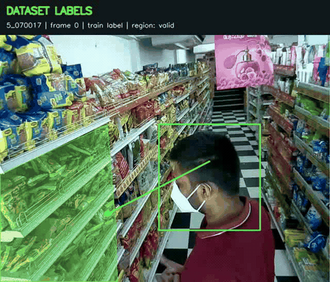
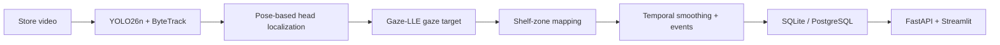

<div align="center">

# ShelfSense

**Explore shopper attention from a single store camera.**

Person tracking · Gaze estimation · Shelf-zone analytics


[Demo](#demo) · [Quick start](#quick-start) · [Video pipeline](#run-on-your-video) · [Results](#measured-results) · [Documentation](#documentation)

</div>

---

ShelfSense connects person tracking, gaze estimation and shelf geometry to study
which shelf zones shoppers may be looking at. It includes attention-event
processing, database ingestion, an API, a dashboard and evaluation tools.

> [!IMPORTANT]
> **This is a research baseline, not a validated retail analytics product.**
> The first Retail Gaze evaluation produced **0 correct target-region hits out
> of 31 eligible labels**, even with annotated head boxes. The pipeline runs;
> accurate product-region estimation remains an open problem.

## Demo

[](docs/assets/retail-gaze-annotated.mp4)

**[▶ Watch the full annotated video (MP4)](docs/assets/retail-gaze-annotated.mp4)**

The preview plays inline and loops. Click it to open the full-resolution video.
This is **dataset annotation visualization**, not model detection or gaze accuracy:
green overlays show the labeled head, gaze target and product region. The clip
comes from Retail Gaze session `5_070017`, with 11.3 seconds of illustrative playback.
See [measured results](#measured-results) for the model's actual performance.

## How it works



| Component | What it does |
| --- | --- |
| **Person tracking** | YOLO26n detects people; ByteTrack associates detections across frames. |
| **Gaze estimation** | YOLO26n-pose estimates head boxes; Gaze-LLE predicts image-space gaze targets. |
| **Shelf mapping** | Camera-specific shelf corners and zone geometry map gaze targets to shelf regions. |
| **Attention events** | Media-time smoothing and duration thresholds identify stable attention episodes. |
| **Analytics** | Validated imports feed zone rankings, observed-gaze heatmaps, coverage and an attention funnel. |
| **Evaluation & previews** | Compare predictions against labels, inspect failure reasons and export annotated videos. |

Missing or ambiguous observations remain **unknown**; the pipeline does not force
every shopper into a shelf zone. L2CS remains available as a legacy gaze backend.

## Quick start

**Requires Python 3.11+.** Try the complete synthetic workflow without installing
ML dependencies or downloading model weights:

```bash
PYTHONPATH=src python3 -m shelfsense smoke --output-dir outputs/smoke-001
```

This exercises attention processing, database ingestion and evaluation, then
writes analytics, raw/smoothed metrics, replay timings and an environment manifest.
It uses synthetic inputs and does not run neural models.

For a smaller tracking-contract demo:

```bash
PYTHONPATH=src python3 -m shelfsense demo --output outputs/demo.jsonl
```

The demo writes 30 synthetic frames containing one moving bounding box.
Choose a **new output path** for each run; existing results are not overwritten.

## Run on your video

### 1. Install the vision and gaze dependencies

```bash
python3 -m venv .venv
source .venv/bin/activate
pip install -e '.[vision,gaze]'
```

Place your footage and model checkpoints locally:

```text
data/
├── shelf.mp4
└── shelf.json                         # Your camera's shelf geometry
models/
├── yolo26n.pt                         # Person detector
├── yolo26n-pose.pt                    # Head localization via pose landmarks
└── gazelle_dinov2_vitb14_inout.pt      # Gaze-LLE decoder
```

See the [Gaze-LLE setup guide](docs/gazelle.md) for checkpoint downloads, CPU
installation and the DINOv2 backbone cache. Footage and weights are not bundled;
first-use model setup may require network access. YOLO26 requires Ultralytics
8.4.0 or newer, as declared by the vision extra.

### 2. Detect, track and estimate gaze

```bash
shelfsense track data/shelf.mp4 \
  --weights models/yolo26n.pt \
  --head-weights models/yolo26n-pose.pt \
  --gaze-weights models/gazelle_dinov2_vitb14_inout.pt \
  --device cpu --max-frames 100 \
  --output outputs/gaze.jsonl
```

For tracking alone, omit `--head-weights` and `--gaze-weights`.

| Option | Purpose |
| --- | --- |
| `--device cpu` | Run on the CPU; use `--device 0` for a supported GPU. |
| `--max-frames 100` | Limit processing for a short check. |
| `--fps 30` | Override missing or incorrect constant-frame-rate metadata. |
| `--calibration data/shelf.json` | Map estimated targets to your configured shelf zones. |
| `--attention` | Enable smoothing and attention events on a calibrated run. |

Use constant-frame-rate footage. Timestamps are derived from frame index and FPS;
variable-frame-rate input is not supported. Detector confidence is not a measure
of tracking identity certainty.

### 3. Configure shelf zones and attention

Copy [the geometry template](configs/shelf.image-target.example.json) to
`data/shelf.json`, then enter the actual frame size, shelf corners and zone layout.
For Gaze-LLE, this mapping uses image-space targets and does not require angle
calibration samples.

Add these options to the tracking command:

```bash
--calibration data/shelf.json --attention
```

Unknown gaze and observation gaps break attention episodes. See
[shelf setup](docs/gazelle.md#shelf-setup-and-run) and
[attention-event rules](docs/attention.md) before interpreting durations.
The [legacy calibration guide](docs/calibration.md) covers L2CS angle mapping and
synthetic replay examples.

## Measured results

The initial Retail Gaze diagnostic processed **339 original images** across three
sessions and scored **43 test-labeled frames** at 640 × 480 resolution. It used
pretrained models without tuning on these clips.

| Metric | Gaze-LLE with annotated heads | Full automatic head pipeline |
| --- | ---: | ---: |
| Accepted gaze predictions | 32 / 43 | 28 / 43 |
| Prediction coverage | 74.4% | 65.1% |
| Mean error on accepted predictions | 108.3 px | 96.2 px |
| Correct target-region hits | 0 / 31 | 0 / 31 |

The error averages use different accepted subsets; the smaller automatic-head
error does **not** establish better accuracy. Five labels lacked mask annotations
and seven gaze points fell outside their referenced masks. Those twelve labels
were excluded from region scoring, but retained for gaze coverage and point error.

The downloaded videos were missing their final annotated frame, so the evaluation
used complete original Kaggle image sequences. These are small-sample diagnostic
results, not a full benchmark or a validation of attention duration.

**Read the [evaluation workflow and findings](docs/retail-gaze.md)** for exact
commands, dataset preparation, metrics and reproducibility details.

### Annotated video previews

The video exporter produces two views per session:

| View | What you see |
| --- | --- |
| **Dataset labels** | Head boxes, labeled gaze arrows and highlighted product regions. |
| **Model comparison** | Three panels: dataset labels, predictions with annotated heads, and predictions with automatic heads. |

Labels are explicitly distinguished from predictions. Frames outside the evaluated
subset say **Not evaluated**, rather than carrying an old prediction forward.
Arrow origins are visual approximations inside head boxes, not measured eye positions.

Follow the [video export instructions](docs/retail-gaze.md#annotated-videos).
Generated videos and their local gallery live under `outputs/retail-videos/` and
are excluded from Git. The selected README demo is copied into `docs/assets/`
so its preview and MP4 are available in the repository.

## Explore analytics

SQLite works without additional dependencies. For PostgreSQL, the API and the
dashboard, install the analytics extra:

```bash
pip install -e '.[analytics,test]'
shelfsense init-db
```

Import a completed, calibrated attention export:

```bash
shelfsense ingest outputs/attention.jsonl --calibration data/shelf.json
shelfsense report --run-id YOUR_RUN_ID
```

Imports are atomic and idempotent. Start the API and dashboard in separate terminals:

```bash
uvicorn shelfsense.api:create_app --factory --host 127.0.0.1 --port 8000
```

```bash
streamlit run dashboard/app.py --server.address 127.0.0.1
```

See [analytics setup and metric definitions](docs/analytics.md) for connection
settings, endpoints and dashboard behavior.

### Docker deployment

Set `SHELFSENSE_POSTGRES_PASSWORD` in a local `.env`, then start the analytics stack:

```bash
docker compose up --build --detach --wait api dashboard
```

Compose starts PostgreSQL, database initialization, the API and the dashboard.
See [deployment instructions](docs/deployment.md) for imports, storage and runtime
checks. Vision evaluation uses separate Docker recipes described in the relevant guides.

## Output contracts

| Schema | Contents |
| --- | --- |
| **1 — Tracking** | Session, frame index, timestamp and tracked person boxes. |
| **2 — Gaze** | Tracking data, image size and gaze observations. |
| **3 — Shelf targets** | Calibration metadata and mapped shelf targets, including explicit unknowns. |
| **4 — Attention** | Smoothed observations, attention events and session-end records. |

Tracking output uses JSONL. Bounding boxes are pixel coordinates `[x1, y1, x2, y2]`;
empty frames are preserved with `tracks: []`. Pair `session_id` with `track_id`
when storing observations. Schema 4 consumers must check `record_type` because
session-end records are not ordinary frames.

Processing is streamed with bounded pipeline memory. A failed run may leave partial
output; do not treat it as complete. OpenCV may report decoding failures as end of
file, so successful completion alone does not prove input-video integrity.

## Verification

Run the unit suite without ML dependencies:

```bash
PYTHONPATH=src python3 -m unittest discover -s tests -v
```

The recorded Retail Gaze validation run discovered **97 tests**: **92 passed** in the CPU
vision image and five optional analytics/PostgreSQL checks were skipped. Host
checks also skip unavailable vision dependencies. Test totals may grow as the
project develops.

Checks cover tracking/gaze contracts, calibration, temporal gaps, session endings,
annotation alignment, mask handling, evaluation denominators and SQLite ingestion.
Pretrained CPU inference and the three-session real-data evaluation also ran
successfully; successful execution is separate from prediction accuracy.
FastAPI, Streamlit and PostgreSQL integration checks require their optional
dependencies and services. See [validation details](docs/deployment.md).

Still unvalidated: deployment-camera accuracy, reliable product-level attention,
tracking identity continuity and real-world attention-duration thresholds.

## Documentation

| Guide | Start here for… |
| --- | --- |
| [Gaze-LLE](docs/gazelle.md) | Weights, CPU setup, model caching and shelf configuration. |
| [Retail Gaze](docs/retail-gaze.md) | Dataset preparation, measured results and video exports. |
| [Calibration](docs/calibration.md) | Legacy angle calibration and synthetic mapping examples. |
| [Attention](docs/attention.md) | Smoothing, thresholds, gaps and event definitions. |
| [Analytics](docs/analytics.md) | Database ingestion, API routes and dashboard metrics. |
| [Evaluation](docs/evaluation.md) | Held-out labels, coverage and experiment records. |
| [Deployment](docs/deployment.md) | Docker setup, services and validation checks. |

## Contributing and release readiness

See [CONTRIBUTING.md](CONTRIBUTING.md) for development and pull requests,
[SECURITY.md](SECURITY.md) for vulnerability reporting, and [ROADMAP.md](ROADMAP.md)
for research priorities. The [fresh-clone CPU build](docs/releasing.md) prepares
locked dependencies and verified model assets without a pre-existing local image.
[Third-party notices](THIRD_PARTY_NOTICES.md) document dependency and demo-media terms.

## Development workflow

Work is organized into reviewed modules, with one commit per module and an owner
push after review. The original implementation plan targeted approximately six
commits; subsequent evaluation work is recorded separately.

Footage, model weights, generated outputs, credentials and the local `project.md`
outline are excluded from Git. The selected documentation demo in `docs/assets/`
is an explicit exception.
